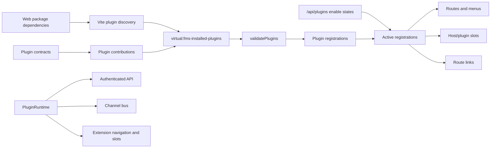

# FMS 全局代码审查与扩展建议

> 审查日期：2026-08-04
>
> 审查范围：宿主应用、插件 SDK、共享契约、workspace 插件、外部插件、测试与构建链路
>
> 审查基准：当前工作树（包含尚未提交的生产 Mock 隔离改动）
>
> 当前定位：可信代码、构建期静态集成的 React 插件化管理后台

## 1. 总体结论

仓库已经具备比较完整的插件基座骨架：

- 宿主可以从 npm/workspace 依赖自动发现插件。
- SDK 定义了页面、模块、插槽、页面入口和消息通道。
- 宿主对路由、菜单、模块和 API 请求使用统一的 RBAC 上下文。
- 插件支持构建期拆包、运行时启停和基础错误边界。
- 内部 one/two 与外部 three 已经跑通了跨插件契约、插槽和通信示例。

当前实现已经从协议演示推进到可用的内网业务基线。当前工作树完成了生产 Mock 隔离、插件发现/注册链路加固、状态恢复、真实 lazy 重试、异步 channel 隔离、Route Catalog、基础无障碍、共享 Query Service，以及工作台、履约报表和承运商评级三条真实数据流程。尚未闭环的重点转为契约所有权、插件样式生命周期、API 凭证边界、CI/生产浏览器自动化和平台可观测性；这些 P2 能力完成前，不建议直接开放不可信第三方插件生态。

### 1.1 当前插件链路

这是一套构建期静态集成模型，不是运行时远程模块系统。插件代码与宿主运行在同一个 React、DOM 和鉴权上下文中，因此当前只能接入可信插件；单纯增加 manifest 校验或 CSS 作用域不能把第三方代码变成安全沙箱。

## 2. 风险等级

| 等级 | 含义                                       | 处理要求             |
| ---- | ------------------------------------------ | -------------------- |
| P0   | 可导致生产环境不安全、不可用或使用错误数据 | 发布前必须修复       |
| P1   | 影响核心插件链路、故障恢复或关键用户流程   | 应在最近一个迭代修复 |
| P2   | 影响扩展性、可维护性、性能或交互质量       | 应进入平台化改造排期 |
| P3   | 工程体验、一致性或低风险优化               | 可随功能迭代持续处理 |

当前优先级最高的未完成项：

| 优先级 | 问题                              | 主要证据                                                                |
| ------ | --------------------------------- | ----------------------------------------------------------------------- |
| P2     | 全局共享契约形成封闭式目录        | `packages/plugin-contracts/src/index.ts`、`external/three/package.json` |
| P2     | 插件 CSS 仍缺少启停生命周期       | `apps/web/fms-plugin-discovery.ts`、`external/three/src/styles.css`     |
| P2     | API Client 的凭证与请求边界不完整 | `apps/web/src/services/api-client.ts`                                   |
| P2     | CI 与生产浏览器烟雾测试尚未建立   | 根目录未发现 CI 配置或 Playwright 项目                                  |

## 3. 已确认问题与已修复项

### 3.1 已修复：生产 Mock、演示登录和启动失败已隔离

原实现会在生产环境默认动态导入 MSW、暴露演示凭证，并在 Mock 启动失败时留下空白页。当前工作树已完成以下修复：

- `apps/web/src/main.tsx:5` 仅在开发模式且显式设置 `VITE_ENABLE_MOCKS=true` 时导入 MSW。
- `apps/web/src/config/environment.ts:2` 和 `apps/web/src/pages/LoginPage.tsx:50` 将演示账号切换和预填密码限制在开发或测试模式。
- `apps/web/vite.config.ts:7` 在生产构建中禁用 `publicDir`，不复制 `mockServiceWorker.js`。
- `apps/web/src/app/bootstrap.tsx:5` 在准备阶段失败时渲染可恢复错误页，不再保持空白。
- `scripts/assert-production-build.mjs:4` 在构建后检查 MSW 标记和演示凭证，根 `build` 已接入该检查。
- `msw` 已从 Web 运行依赖移动到开发依赖。

本次执行 `pnpm build` 和产物全文检索均通过，`apps/web/dist` 不包含 `mock-admin-token`、`admin123`、`viewer123`、`setupWorker`、`mockServiceWorker.js` 或演示账号文案；开发模式登录和启动失败路径也有浏览器检查及聚焦测试。

注意：这些修复目前仍是未提交改动，合并时应将代码、测试、环境文件和产物检查脚本作为同一批变更提交。

### 3.2 已修复：插件发现、加载与运行时校验已隔离

当前 Vite 发现器只读取 `package.json` 并生成 `PluginPackageDescriptor`，不再静态执行插件入口。宿主通过 `loadPluginRegistrations` 和 `Promise.allSettled` 逐包加载，Zod 将每个运行时值作为 `unknown` 解析；`null`、缺失 manifest、非函数 loader、缺少 `plugin` 导出和顶层抛错都只产生当前包的 error registration。

注册诊断现在包含 packageName、packageVersion、manifest、阶段、稳定错误码、字段路径和 error/warning 严重度。不兼容包不会执行，但会保留在插件中心；包版本、`fmsPlugin.id/apiVersion` 与 manifest 会进行一致性校验。三个真实插件已补齐 `fmsPlugin.id`，外部 three 的样式也随其动态描述符隔离加载。

聚焦测试覆盖上述失败路径，真实浏览器确认 three/one/two 均显示包名、版本、ready 状态且动态路由可进入。

### 3.3 已修复：插件状态故障可见且保留成功快照

`PluginRegistryProvider` 已将启停状态建模为 `idle/loading/ready/error` 判别联合，并通过请求序号隔离刷新竞态。`/api/plugins` 失败时，同一用户的最后成功快照会继续驱动菜单和路由；Layout 与插件中心展示错误原因和重试入口，初次加载失败且无快照时开关显示为“状态未知”，不会伪装成全部停用。

Web 集成测试覆盖“先成功、刷新失败、快照保留、再次重试恢复”，真实浏览器确认插件中心三项开关仍显示正确状态。

### 3.4 已修复：插件组件加载失败可以真实重试

`PluginRenderer` 使用 retry generation 重建 `React.lazy` 和 Error Boundary。首次 loader reject 后点击“重试”会执行新的 loader Promise；典型 stale-chunk 错误还会显示“刷新页面”恢复入口。

回归测试覆盖 loader 首次 reject、第二次 resolve，并断言插件内容成功恢复且 loader 调用两次。

### 3.5 已修复：同步与异步消息异常均被隔离

`subscribe` 和 `subscribePublic` 的监听器类型已扩展为 `void | Promise<void>`。消息分发器会同步捕获普通抛错，并在 Promise 创建后立即附加 rejection handler；失败日志包含发送插件、接收插件和 topic，健康订阅者不受影响。

SDK 测试覆盖异步监听器 await 后抛错、健康订阅者继续接收和统一错误报告。耗时、correlation ID 和结构化 telemetry 仍属于 Phase 4 宿主能力注册表范围。

### 3.6 已修复：共享查询消除重复请求并恢复真实数据页面

宿主已经通过 `PluginRuntime.query` 提供自建 Query Service，统一处理稳定 query key、跨插件缓存和并发去重、取消、超时、指数退避、手动刷新和 Schema 解析。缓存实例按登录用户创建和清理，避免账号切换后复用上一用户数据。

`DashboardPage` 与 one 插槽共同订阅 `['fms', 'dashboard']`，集成测试确认 `/api/dashboard` 只请求一次；宿主渲染五项 KPI，one 渲染三个业务指标。two 和 three 使用 `@fms/plugin-contracts` 中的 Zod DTO，已分别形成可筛选排序的履约报表、承运商评级和风险摘要，并统一处理 loading/error/empty/ready、刷新失败保留旧数据和最后更新时间。

当前 Query Service 已覆盖本阶段所需基础能力。后续仍可增加分页查询、预取、聚焦重新获取、离线策略、持久缓存和查询级 telemetry，但不再属于原 P1 数据丢弃问题。

### 3.7 已修复：宿主路由、菜单和默认首页使用统一 Catalog

`apps/web/src/app/route-catalog.ts` 现在统一声明宿主 path、权限、菜单、排序、保留路径、fallback 和宿主插槽。`App` 从 Catalog 生成路由，`AppLayout` 从同一份配置生成权限过滤后的菜单；宿主入口和插件入口共同参与“首个可访问页面”计算。

只拥有 `reports:view` 的 reporter 登录后会进入 `/reports`，不会先看到 Dashboard 403；登录拦截保存并恢复 `pathname + search + hash`，不接受外部 URL 或登录页自循环。菜单选中状态使用 `matchPath`。

### 3.8 P2：全局共享契约形成封闭式插件目录

`@fms/plugin-contracts` 中的 `workspaceContract.plugins` 固定枚举 one、two、three。外部 three 插件的自身契约也由宿主仓库定义。因此，新增插件或跨插件能力时，需要先修改并发布中央契约包，使外部插件无法完全独立演进。

建议调整为“能力提供方拥有契约”：

- 通用类型保留在 `@fms/plugin-sdk`。
- 宿主插槽放入 `@fms/host-contracts`。
- two 的页面、插槽和 channel 由 `@fms/plugin-two-contract` 发布。
- three 的路由契约由 three 自己或独立 contract 包发布。
- manifest 声明 required/optional capability 及 semver 范围。

`external/three/package.json` 当前还声明了未在源码中使用的 `@fms/plugin-two` peer dependency，与“通过共享契约避免插件互相依赖”的目标冲突，应删除。

### 3.9 P2（部分已修复）：依赖图已建立，路由策略仍需收紧

manifest 现在支持 required/optional plugin 和 capability SemVer，校验必选依赖缺失、版本不匹配、目标注册失败、能力提供方失效、自依赖和循环依赖；错误会沿必选依赖和跨插件贡献传播。Schema 同时校验有限数值和 loader 函数。

仍需在后续路由贡献协议扩展中明确：

- 路由语法、动态参数、通配符、根路径、大小写和尾斜线规则。
- 是否允许插件级联停用，以及 optional 贡献在目标未安装时的降级约定。
- 插槽嵌套关系是否需要独立于插件依赖图进行循环检测。

运行时启停依赖影响和版本升级预检仍属于插件中心 2.0 的范围。

### 3.10 P2（部分已修复）：插件 CSS 仍缺少生命周期边界

发现器会在虚拟模块中无条件导入所有插件样式，因此即使插件被停用，其 CSS 仍会加载。内部 one/two 仍依赖宿主 `@source '../../../plugins'` 扫描 workspace 源码，将这些包发布到 npm 并在其他宿主安装后，Tailwind utility 可能没有对应 CSS。

真实断点检查还发现外部 three 的裸 `.grid-cols-1` 会在动态注入后覆盖宿主的响应式工具类，使 1024px 工作台退化为单列。three 现已通过 Tailwind `prefix(three)` 生成命名空间工具类，生产产物检查会拒绝未命名空间的 `.grid-cols-1`；修复后 1024px 工作台恢复为 2 列 KPI 和 3 列扩展指标。

建议：

1. 每个可发布插件构建并导出带插件前缀或根作用域的 CSS 产物。
2. 对插件根节点使用 `data-plugin-id` 作用域，禁止全局 reset。
3. 规范 Tailwind layer 顺序、工具类前缀和设计 token，保证宿主与插件可预测。
4. 对样式是否随插件启停动态加载做明确取舍，并为停用后的资源清理增加生命周期协议。
5. 如需开放不可信插件，应使用 iframe 或其他独立运行域，不能只依赖 CSS 作用域。

### 3.11 P2：宿主 API Client 能力与安全边界不完整

当前 API Client 只实现 GET、POST 和 PATCH，没有基础 URL、超时、统一重试、文件上传下载、204 响应语义或运行时响应校验。`PluginApiClient` 还接受任意字符串 URL，并自动附加 Bearer token。在当前“插件与宿主同运行域且完全可信”的前提下，这不是安全隔离；但仍应防止插件因误配把 token发送到外部域名。

建议默认只允许同源 `/api/` 路径，外部请求使用不带凭证的独立 client；生产环境优先考虑 BFF 与 HttpOnly/SameSite Cookie，降低 XSS 和同运行域插件读取 Bearer token 的风险。

### 3.12 P2（部分已修复）：测试覆盖增强，CI 与生产烟雾仍缺失

当前类型检查、Lint 和现有 56 个测试全部通过；发现器、畸形 manifest、加载隔离、依赖/能力版本、状态 API 失败、lazy 重试、异步 channel、Route Catalog、Query Service、DTO Schema、业务页面和 axe 均有聚焦回归。

one/two 已新增独立组件测试，不再依赖 `--passWithNoTests`；jsdom 环境会跳过 MSW 人工延迟，App 测试也关闭了无意义的深层 `pointer-events` 检查。本次 Web 的 31 个测试仍耗时约 45.80 秒，筛选和跨插件路由集成用例单项约 4-7 秒，仍需通过更轻量的测试宿主、减少重复登录/注册初始化或拆分端到端层继续优化。剩余缺口包括：

- axe 已在 jsdom 覆盖登录页和工作区，但没有自动化的真实生产构建浏览器烟雾测试。
- 仓库未发现 GitHub Actions、GitLab CI 或其他 CI 配置。
- 尚未设定覆盖率门槛，也未自动执行 pack/install 兼容性矩阵。

建议 CI 至少包含 typecheck、lint、unit test、build、pack dry-run、生产产物检查、Playwright 烟雾测试和插件 SDK/Registry 聚焦覆盖率门槛。

### 3.13 已修复：移动端导航折叠入口具有可访问名称

`AppLayout` 为 overflow indicator 提供了 Lucide 图标和“更多导航”名称。375px 真实浏览器快照中折叠入口暴露为 `menuitem "更多导航"`；375、768、1024、1440 四个视口的 document scroll width 均等于 viewport width。

插件数量继续增长后，仍建议在 Phase 4 改为可折叠侧边栏或移动端抽屉，并支持业务域分组，而不是继续依赖横向菜单自动折叠。

### 3.14 P3（部分已修复）：可访问性与导航交互可继续改善

已完成：

- 403/404 页面已消除 `<Link><Button /></Link>` 嵌套交互元素。
- 主 Layout 已增加“跳转到主内容”链接和可见 `focus-visible` 基线。
- 登录、Dashboard、插件中心、履约报表和承运商评级具有稳定的 `h1`；核心异步区具有最小高度。
- admin、viewer、reporter 使用明确角色标签，未知角色回退原始 role，不再统一误报为“查看者”。
- 登录页与已登录工作区通过 axe 自动检查，键盘第一焦点为跳过导航链接。

仍需改善：

- 顶部横向菜单适合当前三个插件，但无法良好承载未来的多业务域和嵌套页面。
- `PluginCenterPage` 使用的 Ant Design `List` 已被标记为废弃，浏览器控制台提示将在下个主版本移除。
- axe 的 color contrast 无法在 jsdom 中可靠计算，仍需在 Playwright/CI 中使用真实浏览器检查。

后台定位应保持安静、紧凑、易扫描的操作界面。插件数量增长后，建议使用可折叠侧边栏、业务域分组、面包屑、最近访问、收藏和全局命令搜索，而不是继续把所有入口堆入横向菜单。

## 4. 工程与代码层优化

### 4.1 已建立共享数据层基线

`WorkspaceQueryClient` 与 SDK 的 `usePluginQuery` 已替换业务页面中重复的 `useState + useEffect + apiClient + loading/error` 组合，当前提供：

- 稳定 query key、按用户缓存和跨插件并发请求去重。
- 最后订阅者卸载后的请求取消、超时、指数退避、错误分类和手动重试。
- stale time、保留旧数据刷新和显式失效。
- 筛选、排序与 URL 状态同步；查询条件进入 query key。
- Zod DTO Schema 校验，畸形响应转为可观察查询错误。

下一阶段可在现有接口上增加服务端分页、预取、聚焦重新获取、离线/持久化策略和查询 telemetry，无需让插件直接依赖另一套状态库。

### 4.2 建立宿主能力注册表

`PluginRuntime` 可以在现有 API、权限、channel 和 extensions 基础上继续提供：

- `logger`：自动附加 pluginId、version 和 traceId。
- `query`：宿主统一的请求缓存。
- `notifications`：统一成功、警告、错误和持久通知。
- `commands`：注册可搜索命令和快捷操作。
- `storage`：按用户和插件命名空间隔离的偏好设置。
- `telemetry`：页面耗时、插件加载、接口失败和通道异常指标。

### 4.3 统一贡献排序

SDK 中的 `sortModuleContributions` 使用“priority + module ID”，宿主实际使用“priority + plugin ID + module ID”。共享工具与宿主行为不一致。应将解析后的贡献排序放入 SDK，路由、模块和页面入口都使用确定性 tie-breaker。

### 4.4 增加模块边界规则

建议使用 ESLint boundaries、dependency-cruiser 或自定义规则限制：

- 插件不得导入 `apps/web/src` 宿主内部实现。
- 插件之间不得直接导入实现包，只能依赖 SDK 或契约包。
- `plugin-sdk` 不得依赖宿主或任何业务插件。
- 契约包不得导入 React 组件或具体业务实现。
- 发布包必须通过 API Extractor 或等价的公开 API 差异检查。

### 4.5 建立包发布流程

建议引入 Changesets 或等价的版本管理流程，对 SDK、契约和插件执行独立 semver，并在发布前检查：

- manifest 版本与 package.json 版本一致。
- peer dependency 范围与宿主支持矩阵一致。
- tarball 不包含测试文件、无关源码或本机配置。
- 动态 chunk、CSS 和 exports 指向的文件全部存在。
- 新旧 SDK 版本的契约兼容性测试通过。

## 5. 现有功能优化

### 5.1 插件中心 2.0

将当前开关列表扩展为插件运维控制台，建议包含：

- 包名、插件 ID、安装版本、可用版本和 API 兼容状态。
- ready、disabled、incompatible、load-error、degraded 等状态。
- 必选/可选依赖图与停用影响预览。
- 插件请求的权限码、菜单、路由、插槽和 channel 清单。
- JSON Schema 驱动的插件配置页。
- 按租户、组织、角色或用户范围启用。
- 批量启停、灰度发布、版本升级和回滚。
- 健康检查、最近错误、资源耗时和操作审计。

页面建议使用密集可扫描表格，设置状态、版本、依赖和健康度列，而不是为整个页面再包裹一层卡片。

### 5.2 导航与工作区

- 可折叠侧边导航，按运输、资源、结算、报表、平台管理分组。
- 页面面包屑、统一标题区、主操作和页面级状态。
- 最近访问、收藏、快速切换和全局命令面板。
- 菜单贡献支持分组、父子级、排序、徽标、打开方式和特性开关。
- 插件路由支持参数页、详情页、子路由和页面内标签。

### 5.3 工作台

已实现基础控制塔：在途运单、待调度、异常待处理、今日完成、准时交付率、最后更新时间和 one 插槽业务指标；共享 Query Service 负责去重、刷新和各类数据状态。

下一阶段建议扩展：

- 即将超时、空驶率、载重利用率、运输成本和承运商 SLA。
- 实时运力和地图轨迹概览。
- 异常按严重度排序，可直接签收、转交、催办或进入详情。
- 按岗位和权限定制仪表盘组件、布局和刷新频率。
- WebSocket/SSE 实时更新，并尊重 `prefers-reduced-motion`。

### 5.4 履约报表

已实现真实运单表格、承运商/状态筛选、列排序、空状态、刷新，以及可复制和回放的 URL 查询；Mock API 按服务端语义执行筛选和排序，three 摘要可以通过 channel 直接更新承运商条件。

下一阶段建议扩展：

- 服务端分页，以及日期、线路、客户和异常类型筛选。
- 可保存视图、列显隐、列宽、固定列和快速筛选。
- 指标钻取到运单、轨迹、POD 和结算明细。
- Excel/CSV/PDF 导出、定时报表和邮件/消息订阅。
- 大数据量下使用虚拟列表、服务端聚合和导出任务。

### 5.5 承运商评级

已实现评分、等级、准时率、事故数、趋势、风险等级、摘要指标、风险筛选和最后更新时间；从评级页可携带承运商 query 跳转履约报表，two 插槽摘要也能发布同一类型化筛选。

下一阶段建议扩展：

- 评分规则版本、权重和手工复核流程。
- 承运商对比、历史趋势、线路维度与异常原因分布。
- 资质到期、保险、合同、黑名单和整改任务。
- 低分或持续下降自动告警，与运单分配和准入策略联动。

## 6. 插件平台可扩展功能

| 能力       | 建议扩展                                        | 主要价值                     |
| ---------- | ----------------------------------------------- | ---------------------------- |
| 插件配置   | manifest 声明 JSON Schema，宿主生成配置表单     | 无需为每个插件编写配置页     |
| 生命周期   | install、activate、deactivate、upgrade、dispose | 支持资源清理、迁移和可观测性 |
| 依赖管理   | required/optional plugin 与 capability semver   | 防止部分启用后功能静默失效   |
| 命令扩展   | 命令面板、快捷键、行操作和批量操作              | 提升高频管理流程效率         |
| 数据表扩展 | 列、筛选器、行操作、导出器和详情面板            | 避免为小型扩展复制整个页面   |
| 表单扩展   | 字段、验证器、默认值、审批步骤                  | 支持业务定制而不修改宿主     |
| 通知扩展   | 站内信、邮件、短信、企业 IM 和 Webhook 适配器   | 统一异常与流程消息出口       |
| 后台任务   | 导出、同步、计算、评分和调度任务状态            | 支持长耗时操作与失败恢复     |
| 多租户     | 租户级插件开关、配置、数据和授权                | 支持 SaaS 化与客户差异化     |
| 国际化     | 契约使用 message key，插件提供 locale 资源      | 避免菜单与错误文案硬编码     |
| 主题系统   | 宿主设计 token、暗色模式、密度和品牌覆盖        | 保持插件视觉一致且可定制     |
| 灰度能力   | 按租户、角色、用户百分比或环境启用              | 降低插件发布风险             |
| 审计与观测 | 插件日志、错误率、加载耗时、API 调用和操作记录  | 快速定位与回滚问题插件       |

## 7. FMS 业务功能扩展

### 7.1 运输订单与调度

- 运输订单、运单、货物、装卸点和时间窗管理。
- 自动/人工调度、拆单、合单、改派和加单。
- 车辆、司机、载重、容积和资质约束。
- 路线模板、里程、通行限制、预计到达和路径优化。

### 7.2 在途可视化与异常中心

- GPS/IoT 位置、轨迹回放、停留和轨迹偏离。
- 围栏进出、温湿度、异常开门、疲劳驾驶和设备离线告警。
- 异常分级、责任人、处理 SLA、升级和关闭原因。
- 异常与运单、承运商、线路和结算的关联分析。

### 7.3 承运商、车辆与司机

- 承运商准入、合同、价格、保险、资质和绩效。
- 车辆档案、年审、保养、维修、能源消耗和设备绑定。
- 司机资质、排班、安全事件、培训和绩效。
- 黑名单、风险标签和自动准入/禁用策略。

### 7.4 POD、客服与理赔

- 电子回单、签名、照片、位置和时间戳。
- 回单 OCR、缺件检查、原件寄回跟踪和归档。
- 客诉、货损、丢失、延误和索赔处理。
- 责任判定、赔付、保险案件和完整审计链。

### 7.5 计费、结算与发票

- 合同价、阶梯价、附加费、最低消费和临时调价。
- 应收、应付、对账单、差异处理和审批。
- 发票申请、红冲、电子发票、回款和核销。
- 运单成本、线路利润、客户利润和承运商利润分析。

### 7.6 流程、待办与通知

- 可配置审批流程，覆盖调价、改派、结算、理赔和承运商准入。
- 统一待办中心、业务日历、超时催办和代办。
- 站内信、邮件、短信、企业微信/钉钉和 Webhook。
- 通知模板、频率限制、升级策略和送达状态。

## 8. 建议实施路线

| 阶段                 | 建议周期 | 主要交付                                               |
| -------------------- | -------- | ------------------------------------------------------ |
| 阶段 0：生产止血     | 已完成   | 生产移除 Mock、登录页分环境、启动恢复、产物泄漏检查    |
| 阶段 1：注册链路加固 | 已完成   | Schema 校验、加载隔离、统一诊断、依赖和能力图          |
| 阶段 2：故障恢复基线 | 已完成   | 状态快照、lazy 重试、异步 channel、Route Catalog、a11y |
| 阶段 3：数据与业务页 | 已完成   | Query Service、DTO、控制塔、报表、评级和跨页联动       |
| 阶段 4：插件平台化   | 2-4 周   | 契约拆分、观测服务、配置、生命周期、租户范围和 CSS     |
| 阶段 5：工程与业务化 | 持续迭代 | CI、发布矩阵、调度、轨迹、POD、结算和高级报表          |

下一步应先完成契约所有权、CSS 生命周期、API 安全边界和自动化门禁，再扩展更多贡献类型或运行时远程插件。否则，扩展点越多，故障传播、契约耦合和运维成本会越快增长。

## 9. 验证结果

| 命令                         | 结果 | 备注                                                               |
| ---------------------------- | ---- | ------------------------------------------------------------------ |
| `pnpm typecheck`             | 通过 | 宿主、SDK、契约、内部插件和外部 three 均通过                       |
| `pnpm lint`                  | 通过 | ESLint 与 Oxlint 未报错                                            |
| `pnpm test`                  | 通过 | 56 个测试通过；Web 31 项耗时 45.80 秒；one/two 均有独立组件测试    |
| `pnpm build`                 | 通过 | Mock/凭证泄漏与外部插件 CSS 命名空间检查通过，无 500 kB chunk 告警 |
| 公开包 `pnpm pack --dry-run` | 通过 | SDK、contracts、one、two、three 的 tarball 都可生成                |
| 四断点浏览器检查             | 通过 | 三页在 375/768/1024/1440 无页面溢出或重叠，移动宽表仅容器内部滚动  |
| 浏览器控制台                 | 通过 | 干净会话依次访问三张业务页后无 `error` 或 `warn`                   |
| axe 与键盘基线               | 通过 | 登录页、工作区无结构违规；首个焦点为跳过导航                       |

产物大小观察：

- 宿主主 chunk：约 `195.98 kB`，gzip 约 `64.12 kB`。
- 最大 Typography/Ant Design chunk：约 `494.88 kB`，gzip 约 `162.85 kB`，低于默认告警线但仍应继续按组件拆分。
- Table 与 Pagination chunk 分别约 `159.03 kB` 和 `185.42 kB`，gzip 分别约 `50.14 kB` 和 `58.11 kB`。
- 业务插件动态 chunk 为 `2.15-6.39 kB`，three 独立样式约 `4.11 kB`，动态拆包正常。
- 生产构建不再生成 MSW 浏览器 chunk，也不复制 `mockServiceWorker.js`。

## 10. 验收标准

当前数据与业务页基线已经完成 1-7，后续平台化验收继续使用以下标准：

1. 生产产物不包含演示账号、Mock token、Mock handler 或 MSW 运行时。
2. 任意一个插件缺失 export、manifest 畸形、顶层抛错或 chunk 加载失败时，宿主仍可登录并访问插件中心。
3. 插件状态服务失败时，界面显示故障与重试，不将其伪装为全部停用。
4. 插件组件加载失败后可以重新发起加载，或给出明确的刷新恢复路径。
5. 同步与异步 channel 监听器的异常都不影响其他订阅者，且可在日志中定位来源。
6. 仅有插件权限的用户登录后能直接进入第一个可访问页面。
7. 相同 query key 的请求可去重，页面卸载后可取消，所有响应通过运行时 Schema 校验。
8. CI 自动执行类型、Lint、单元、构建、打包、产物、浏览器烟雾和无障碍检查。

## 11. 审查边界

- 仓库中没有后端实现，本次只审查前端对 API、权限和插件状态的消费方式，无法确认服务端鉴权、租户隔离和审计是否成立。
- 本次没有执行依赖漏洞扫描、许可证扫描、覆盖率统计和真实弱网/离线测试。
- 浏览器检查覆盖开发模式下的登录、工作台、插件中心、履约报表和承运商评级，视口为 375、768、1024、1440；没有执行真实弱网和生产构建浏览器烟雾测试。
